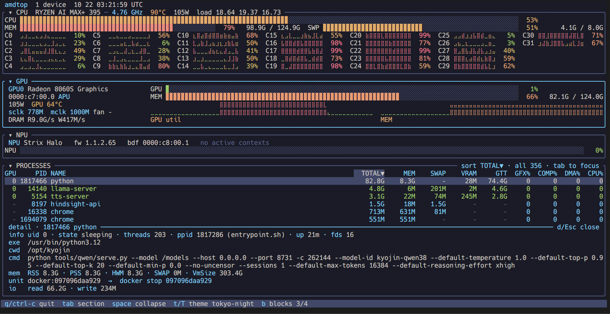

# amdtop — unified-memory fork

> A personal fork of [lhl/amdtop](https://github.com/lhl/amdtop), based on
> v0.2.6 (`0f66724`). Published at
> [kamjin3086/amdtop](https://github.com/kamjin3086/amdtop), default branch
> `feat/process-sort`. **Not intended for upstream submission.**
>
> Everything below the divider is the upstream README, kept verbatim. Only the
> section above it describes this fork.



*The process table sorted by `TOTAL` (`MEM + SWAP + VRAM + GTT`) on a Ryzen AI
MAX+ 395. `llama-server` leads with 5.6G even though its resident memory is only
197M: the rest is GPU GTT and pages compressed into zram. `hindsight-api` and
`dnf5daemon-serv` never touch the GPU, yet they are the next largest consumers.
The footer shows the keys this fork adds.*

## Why this fork exists

On a Strix Halo (Ryzen AI MAX+) box, `btop`/`top` reported roughly 23 GiB of
memory in use while the process list added up to less than 10 GiB. That gap is
not a leak: a large part of unified memory is never part of any process' RSS —
zram-compressed swap pages, GPU GTT/VRAM, page cache, tmpfs/shmem and kernel
slab. amdtop's process table made this harder to reason about because it only
listed DRM clients, so a process that pins gigabytes through RSS + swap (as
containerised services often do) did not show up at all.

This fork turns the process table into an answer to *"what is actually holding
my unified memory, and what can I do about it?"* — without changing how the
rest of amdtop works.

## What this fork changes

| Area | Change |
|---|---|
| **Process list** | Lists **every** process, not just GPU clients. Kernel threads and zombies (no address space) are filtered out. `a` toggles back to GPU clients only. |
| **`TOTAL` column** | `MEM + SWAP + VRAM + GTT` — resident memory, pages compressed into zram, and memory owned by the GPU driver, in one sortable number. |
| **`SWAP` column** | `VmSwap` from `/proc/<pid>/status`. Swapped-out pages still occupy physical RAM inside zram, which is why a heavy process can look tiny in a resident-only view. |
| **Column-cursor sorting** | `←`/`→` walk the sortable columns and sort the focused one biggest-first; the cursor cycles, and from the unsorted view it enters at `TOTAL`. `Esc` clears. The active column is drawn as an inverted header cell with a `▼`. |
| **Detail pane** | `d` (or `Esc`) toggles a full-width pane under the table for the selected process: command line (wrapping to a second row), executable, cwd, state/uid/threads/ppid/uptime/fds, `RSS`/`PSS`/`HWM`/`SWAP`/`VmSize`, io counters, and the owning systemd unit or container scope with the command that manages it. GPU numbers are not repeated — the selected row already shows them. |
| **Graceful stop** | `x` opens a small confirmation dialog and sends **SIGTERM only**. Init (PID 1), amdtop itself and other users' processes are refused up front; the dialog warns when the target belongs to a supervised unit whose restart policy may bring it back. amdtop never calls `systemctl`/`docker`: those force-kill after their own timeout, which would break the "ask, never force" contract. |
| **Compact layout** | CPU frequency/temp/power/load moved into the CPU box title, `MEM` and `SWP` share a row, the core grid uses more columns on wide terminals (32 cores: 4 rows instead of 8), an idle NPU collapses to two rows, and each GPU band lost its label row. On a 50-line terminal the process table went from ~12 visible rows to ~24. |
| **Persistence** | The sort column and the all/GPU filter are stored in `state.json` next to the existing collapse/theme state. |

## Keys added by this fork

| Key | Action |
|---|---|
| `←` / `→` | Move the sort cursor across columns (cycles; enters at `TOTAL`) |
| `Esc` | Unwind one layer: close the detail pane, then clear the sort, then quit |
| `d` | Show / hide the detail pane for the selected process |
| `x` | Stop the selected process (confirmation first, `SIGTERM` only) |
| `a` | Show all processes / GPU clients only |
| `j` `k`, `PgUp` `PgDn`, `Home` `End` | Scroll the process list |

Upstream keys (`q`/`Ctrl+C`, `Tab`, `Shift+Tab`, `Space`, `t`/`T`, `b`/`B`, and
the hidden `r` device refresh) are unchanged; only `Esc` became multi-stage.

## Install this fork

Do **not** use `cargo install amdtop` — that installs the upstream release
without any of the above.

```sh
# Straight from GitHub (feat/process-sort is the fork's default branch):
cargo install --git https://github.com/kamjin3086/amdtop --force

# Or from a local checkout:
git clone https://github.com/kamjin3086/amdtop.git
cd amdtop
cargo install --path . --force
```

Build prerequisites are the same as upstream: Rust 1.88 or newer and the
`libdrm` development headers (`libdrm-devel` on Fedora, `libdrm-dev` on
Debian/Ubuntu, `libdrm` on Arch), plus an AMD GPU/APU running the `amdgpu`
kernel driver.

`cargo install --path .` replaces the `amdtop` binary in `~/.cargo/bin`. To go
back to the stock release later, run `cargo install amdtop --force`.

## Notes and limitations

- The fork tracks upstream `v0.2.6`; `libamdgpu_top` is pinned to `=0.11.5`
  exactly as upstream does, so the fork inherits upstream's telemetry support
  for new kernels and firmware.
- `TOTAL` adds shared pages once per process, so summing the column over-counts
  memory that several processes map. Use it to rank processes, not to compute
  the system total; the CPU section's MEM/SWP bars remain authoritative.
- GPU memory of processes you cannot read is not attributable: root processes
  (including anything running inside a root-owned container) do not expose
  `/proc/<pid>/fdinfo` to a normal user, so their GTT/VRAM shows as `-`. When
  the kernel's device counter exceeds the sum of readable processes by more
  than 512 MiB, the GPU box title reports the remainder, e.g.
  `GPU  74.5G unattributed (root/container processes; run as root)`. Running
  amdtop as root attributes those processes too.
- Everything here was validated on a Strix Halo APU (Ryzen AI MAX+ 395, 32
  cores, XDNA NPU) under Fedora; discrete-GPU setups take the same code paths
  but have not been tested.

---

# amdtop

**amdtop is an independent terminal system monitor for AMD systems.** It is
inspired by the modern TUI visual style of
[nvitop](https://github.com/XuehaiPan/nvitop) and
[btop](https://github.com/aristocratos/btop), and leverages the published
[`libamdgpu_top`](https://crates.io/crates/libamdgpu_top) crate for AMD GPU
telemetry. It monitors CPUs, AMD GPUs (discrete and APUs), and Strix Halo XDNA
NPUs.


## Why

`nvitop` is great but NVIDIA-only. On AMD — especially a Strix Halo box with an
APU **and** an XDNA NPU, or a workstation with multiple AMD cards there was no 
single TUI with that look-and-feel. amdtop fills that gap by combining its own
CPU/system monitoring with `libamdgpu_top` telemetry in a modern, themeable
layout.

## Features

- **Collapsible CPU / GPU / NPU / Processes sections** (state persists across runs)
- **CPU section, btop-style**: per-core grid with braille history mini-graphs,
  package temp/power, load average, plus system MEM/SWP
- **Multi-GPU**: one band per device, labeled by index + PCI bus-id
- **APU-aware memory**: shows the real GTT (unified system RAM) pool on APUs,
  VRAM on discrete cards — both labeled `MEM`
- **Adaptive memory-bandwidth telemetry**: shows memory-controller utilization
  where available alongside SoC DRAM read/write throughput on supported APUs
- **XDNA NPU**: presence detection on `/sys/class/accel`; utilization + per-context table when the `amdxdna` driver exposes DRM fdinfo telemetry
- **Process table**: per-process resident system memory (`MEM`), VRAM/GTT,
  and engine usage
- **41 native bundled themes**: available without btop or external data files;
  cycle live with `t`/`T`. Defaults to `tokyo-night`.
- nvitop-style fixed-track gauges with aligned numeric columns; braille area
  graphs with theme-gradient fills

## Install

Requires **Rust 1.88 or newer** and **`libdrm` development headers**, plus an
AMD GPU/APU running the `amdgpu` kernel driver.

Install from crates.io:

```sh
cargo install amdtop
```

On Arch Linux and derivatives, install the
[`amdtop`](https://aur.archlinux.org/packages/amdtop) AUR package
([pkg](https://github.com/lhl/amdtop-aur)):

```sh
yay -S amdtop
```

Or install the latest development version from Git:

```sh
cargo install --git https://github.com/lhl/amdtop
```

This installs the `amdtop` binary. The published `libamdgpu_top` crate is
pulled from crates.io and compiled automatically. The only runtime dependency
is `libdrm_amdgpu.so.1`, which is present on systems with AMD drivers.

Distro packages for the `libdrm` build headers:

| Distro | Package |
|---|---|
| Arch | `libdrm` |
| Debian/Ubuntu | `libdrm-dev` |
| Fedora | `libdrm-devel` |

### NPU telemetry requirements

`amdtop` detects AMD XDNA/Ryzen AI NPUs through the Linux accel class
(`/sys/class/accel` and `/dev/accel/accel*`). Device detection is enough to show
identity and firmware information, but not live utilization.

Utilization and per-context monitoring require a cumulative `drm-engine-*`
busy-time counter from the loaded `amdxdna` kernel module. A `drm-driver` line
or an installed DKMS package alone is not sufficient. XDNA driver trees also
currently emit more than one engine-key name, and released telemetry parsers do
not recognize all of them.

> **Temporary Arch/AUR caveat (checked 2026-07-22):** the examined
> `amdxdna-dkms` package's kernel allowlist permits only Linux 6.17, 6.18, and
> 6.19. On other kernel versions, installing the package may leave its source in
> `/usr/src` without building or loading a DKMS module. Check `dkms status` and
> the loaded module rather than treating package installation as success.

See the [XDNA NPU telemetry and workload guide](docs/NPU.md) for direct fdinfo
checks, the current driver/parser compatibility matrix, matched XRT/driver build
instructions, Arch package caveats, memlock setup, validation workloads, and
troubleshooting.

## Usage

```sh
amdtop
```

### GPU numbering

amdtop lists all physical GPUs in PCI BDF order and shows each BDF beside its
index. This normally matches the physical ordering from `rocm-smi` and
`rocminfo`. `HIP_VISIBLE_DEVICES` and `ROCR_VISIBLE_DEVICES` can hide or remap
GPU ordinals inside a particular compute process; they do not change amdtop's
system-wide numbering. Use the displayed PCI BDF as the authoritative mapping.

### Keybindings

| Key | Action |
|---|---|
| `q` / `Esc` / `Ctrl+C` | quit |
| `Tab` / `Shift+Tab` | move between sections |
| `Space` / `Enter` | collapse / expand the focused section |
| `t` / `T` | next / previous theme |
| `b` / `B` | next / previous gauge block style |

Section collapse state, the selected theme, and the gauge block style all
persist across runs.

## Configuration

amdtop stores its UI state in:

```text
$XDG_CONFIG_HOME/amdtop/state.json
```

If `XDG_CONFIG_HOME` is unset, it uses `~/.config/amdtop/state.json`.

### GPU power management

A GPU that is already runtime-suspended when amdtop starts remains listed as
`sleeping`; amdtop does not wake it merely to collect telemetry. When another
workload wakes the GPU, amdtop initializes its telemetry in place without
changing the GPU's index.

For GPUs that are awake when monitoring begins, amdtop keeps discrete-GPU
device handles open. This avoids stale utilization and sensor readings after a
low-power transition or system resume. To allow runtime D3Hot power management
while amdtop is running, set `AGT_NO_DROP=0`; doing so may make telemetry
unavailable until amdtop is restarted.

### Gauge block styles

Cycle the bar fill glyph with `b`/`B`:
`3/4` (▊, default), `smooth` (precise fractional █), `dotmatrix` (⣿ LED cell),
`lines` (━/─), `squares` (■/□), `rects` (▮/▯), `pills` (▰/▱).

## Themes

amdtop embeds 41 themes in its binary, so theme selection does not depend on
btop being installed. Native custom themes use amdtop's versioned TOML format
and can independently style CPU, GPU, memory, NPU, processes, borders, clocks,
power, fans, bandwidth, and positioned gradient stops.

User themes are loaded from `$XDG_CONFIG_HOME/amdtop/themes/` and
`~/.config/amdtop/themes/`; system themes may be installed under
`/usr/local/share/amdtop/themes/` or `/usr/share/amdtop/themes/`. A native file
with the same name as a bundled theme overrides it. See
[the native theme format](docs/THEMES.md) for the complete schema and examples.

## Credits

- AMD GPU telemetry: [`libamdgpu_top`](https://crates.io/crates/libamdgpu_top) by Umio-Yasuno
- Inspiration: [nvitop](https://github.com/XuehaiPan/nvitop), [btop](https://github.com/aristocratos/btop)
- Themes from btop and original theme authors; see [THIRD_PARTY.md](THIRD_PARTY.md)

## License

Apache-2.0
